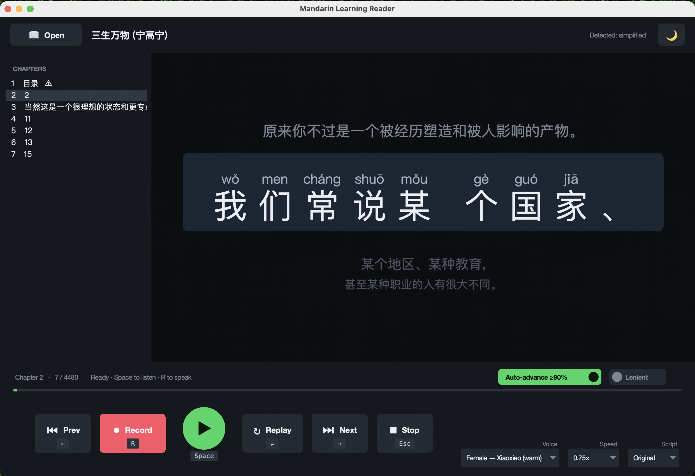

# Mandarin Learning Reader

A free app that turns any Chinese e-book into a **patient Mandarin tutor**. It
shows you one sentence at a time — big and clear, with the **pinyin
(pronunciation) printed above every character** — reads it aloud in a natural
voice, and then **listens to you say it back** and tells you which characters you
got right. Score well enough and it moves you on to the next line automatically.

It's built for anyone learning to read and speak Mandarin who would rather learn
from real books than flashcards. Everything runs on your own computer, for free —
no account, no subscription, and your voice never leaves your machine.

It comes in two looks: a **modern media-player interface** (recommended) that
feels like a cross between Spotify, Audible, and a karaoke machine, and a
**classic reader**. Both do exactly the same thing.

> 🌐 **Prefer a quick, non-technical tour?** See the showcase page →
> https://lyhjeremy.github.io/mandarin-learning-reader/


---

## What you can do with it

Think of it as a read-along that also *checks your pronunciation*. There are four
things going on — read, listen, speak, and get corrected — plus a handful of
conveniences that keep it out of your way.

### 📖 Read

- **Pinyin above every character.** You never have to stop and look up how a word
  is said — the tone-marked pronunciation sits right above each character.
- **One sentence at a time.** The current sentence is large and centred; the
  sentence before and after it sit faded above and below, so you always have
  context without being overwhelmed.
- **Sensible sentence sizing.** Long paragraphs are broken into short, speakable
  lines at natural pauses — periods, commas, colons, and other punctuation — and
  any lines that come out too short are stacked back together, so each unit is a
  comfortable mouthful, never a single character or a runaway paragraph.
- **Simplified or Traditional — your choice.** Reading a Simplified book but more
  comfortable with Traditional characters (or the other way round)? Flip the whole
  text either way with one menu, any time.

### 🔊 Listen

- **Natural-sounding voices.** Each sentence is read aloud in a lifelike Mandarin
  voice. You can pick **male or female**, and **Mainland or Taiwan** accents.
- **Five speeds.** Slow it right down while a phrase is new (½ speed), then speed
  back up as it clicks — 0.5×, 0.75×, normal, 1.25×, or 1.5×.
- **Instant replays.** Once a sentence has been read, playing it again is instant,
  so you can loop a tricky line as many times as you like.

### 🎤 Speak, and get corrected

- **Say it back.** Press **Record**, read the sentence out loud, and press again
  when you're done.
- **Character-by-character feedback.** The app compares what you said to the
  sentence and colours **each character**:
  - 🟢 **green** — you said it correctly
  - 🟠 **amber** — right sound, wrong character (a close miss)
  - 🔴 **red** — missed
  - It also shows an overall **accuracy score** for the attempt.
- **Auto-advance.** Get **90% or higher** and it automatically moves to the next
  sentence — so a good run flows without touching the mouse. (You can switch this
  off and step through manually.)
- **A gentler mode.** Turn on **Lenient** grading and near-misses that *sound*
  right still count, so homophones don't feel unfairly punished.
- **Completely private.** The listening happens **entirely on your computer** —
  your microphone audio is never uploaded anywhere.

### 🧰 Stays out of your way

- **Remembers where you were.** Close it and reopen it, and you're right back on
  the same book, chapter, and sentence — with your chosen voice, speed, and
  settings intact.
- **Chapter list.** Every chapter is listed down the side; cover, copyright, and
  contents pages are flagged so you can skip straight to the real reading.
- **Light and dark themes**, and a full set of **keyboard shortcuts** so you can
  drive the whole thing without reaching for the mouse.
- **Works offline.** After a one-time setup, it needs the internet only to fetch a
  new sentence's audio the first time — everything else, including the speech
  checking, runs on your machine.

## What it looks like

**Reading and listening** — the current sentence is large with pinyin above every
character; neighbouring lines sit faded above and below, like scrolling lyrics.
The round green button plays, and every button shows its keyboard shortcut:



**After you speak** — each character is marked green / amber / red, with your score
on the transport bar:


Prefer a lighter look? A one-tap toggle (🌙 / ☀️) switches the whole app to a
light theme.

## Getting started

You'll need a computer (Mac, Windows, or Linux) with **Python** installed — a free
programming tool that many computers already have. If you don't, download it from
[python.org](https://www.python.org/downloads/) (any version 3.9 or newer) and run
the installer.

Then, in a terminal, from this folder:

```bash
# 1. Install the pieces it needs (one time)
pip install -r requirements.txt

# 2. Start the app — the modern player
python3 mandarin_learner_gui_v2.py

# …or the classic reader, if you prefer
python3 mandarin_learner_gui.py
```

A window opens. Click **Open**, pick a Chinese e-book, and you're reading.

**Two things to expect the first time:**

- **The first time you press Record**, the app downloads its speech-recognition
  brain (a one-time download, roughly the size of a large app). After that, speech
  checking works offline and instantly.
- **Your computer may ask for microphone permission** the first time you record —
  say yes (on a Mac: System Settings → Privacy & Security → Microphone).

## The controls

Everything is a button along the bottom, and most have a keyboard shortcut too:

| Button | Shortcut | What it does |
|---|---|---|
| ▶ **Play** | `Space` | Read the current sentence aloud |
| ● **Record** | `R` | Start recording your voice; press again to stop and be graded |
| ↻ **Replay** | `Enter` | Play the sentence again |
| ⏮ / **Next** | `←` / `→` | Go to the previous / next sentence |
| ⏹ **Stop** | `Esc` | Stop playing or recording |
| **Voice / Speed / Script** | — | Pick the narrator, how fast, and Simplified/Traditional |
| **Auto-advance ≥90%** | — | Move on automatically after a good attempt (on by default) |
| **Lenient** | — | Accept near-misses that sound right |
| 🌙 / ☀️ | — | Switch between light and dark themes |

## Questions you might have

- **Does it cost anything?** No. It's free and open source, with no account or
  subscription.
- **Do I need to be online?** Only briefly. It fetches each new sentence's audio
  from a free voice service the first time you play it (then remembers it). The
  speech-checking runs entirely on your computer.
- **Is my voice recorded or uploaded?** It's recorded only so it can be checked on
  your own machine, then discarded. Nothing is uploaded.
- **Which books can I use?** Any Chinese `.epub` file you own or that's in the
  public domain. The app comes with **no books** — you bring your own.
- **I'm learning Simplified but my book is Traditional (or vice versa).** Use the
  **Script** menu to flip it. The grading understands both, so a correctly-read
  character counts either way.

## For tinkerers

The app is split cleanly into three files, so all the logic lives in one place:

| File | What it is |
|---|---|
| `mandarin_learner_gui_v2.py` | The **modern player** interface (recommended) — karaoke stage + media-player transport bar |
| `mandarin_learner_gui.py` | The **classic** windowed interface — same features, simpler layout |
| `mandarin_learner.py` | A command-line version, handy for testing |
| `mandarin_learner_engine.py` | The engine: reading EPUBs, sentence splitting, pinyin, voices, speech recognition, and grading — no interface, just logic (shared by both) |

The command-line tool lets you inspect the engine without opening the window:

```bash
python3 mandarin_learner.py book.epub --list                 # chapters, with page-count and junk flags
python3 mandarin_learner.py book.epub --chunks --chapter 3   # how a chapter is split into learning units
python3 mandarin_learner.py book.epub --pinyin --chapter 3   # those units with pinyin
python3 mandarin_learner.py --grade "我是學生" "我是學森"     # try the pronunciation grader directly
```

The full design and build notes live in
[`MANDARIN_LEARNER_OVERVIEW.md`](MANDARIN_LEARNER_OVERVIEW.md). Under the hood it
reuses the pipeline of its sibling project,
[epub-to-audiobook](https://github.com/lyhjeremy/epub-to-audiobook), and is built
with Python, Microsoft's free `edge-tts` voices, the offline
`faster-whisper` speech recogniser, `pypinyin` for pronunciations, and `OpenCC`
for Simplified/Traditional conversion. Any of these that's missing simply disables
its one feature rather than stopping the app.

## A note on the books you use

This tool is for studying with books **you own or that are in the public domain**.
The repository ships no copyrighted books or audio — you supply your own EPUB
files, and everything you do stays on your computer.

## License

[MIT](LICENSE) © 2026 Jeremy Lee
