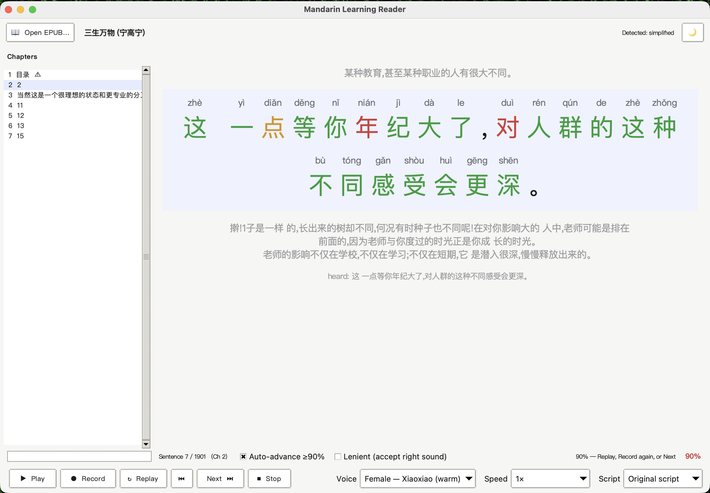

# Mandarin Learning Reader

A desktop app that turns any Chinese EPUB into a read-aloud, speak-back Mandarin tutor: pinyin over every character, neural text-to-speech, and offline speech recognition that grades your reading character by character.

[Live site](https://lyhjeremy.github.io/mandarin-learning-reader/) · [Write-up](https://lyhjeremy.github.io/mandarin-learning-reader/overview/)

Design and copy follow [these standards](https://github.com/lyhjeremy/lyhjeremy/blob/main/DESIGN_STANDARDS.md).



## What it does

- Splits each chapter into learning units of about 7 to 15 characters at Chinese punctuation, joining short sentences and never cutting long ones.
- Sets tone-marked pinyin over every character with pypinyin, reading each run of characters as a phrase so characters with several readings get the right one.
- Reads each unit aloud with one of six Microsoft edge-tts neural voices (four Mainland, two Taiwan) at 0.5×, 0.75×, 1×, 1.25× or 1.5×, and caches the audio so replays are instant.
- Records you reading the line, transcribes it locally with faster-whisper (`small` model by default), and marks each character right or missed with an accuracy score. At 90% or higher it advances to the next line; this can be switched off.
- Converts the whole book between Simplified and Traditional with OpenCC.
- Remembers the book, chapter, line and settings between sessions, and flags cover, copyright and contents pages in the chapter list.

## How the grader works

`grade()` in `mandarin_learner_engine.py` aligns the transcript against the original with `difflib.SequenceMatcher`, so one skipped character doesn't shift every mark after it. Whisper often writes Mandarin in Traditional characters regardless of the source, so both sides are converted to Simplified before comparing (學 and 学 count as the same), while the display keeps the book's characters. Lenient mode compares the pinyin of substituted characters, ignoring tone by default, and counts a match (shown amber).

<pre>
$ python3 mandarin_learner.py --grade "我是學生" "我是學森"
original : 我是學生
heard    : 我是學森<!-- ledger-allow: checkmark, emoji -->
marks    : ✓✓✓✗
accuracy : 75%   auto_advance=False
</pre>

## Limitations

- The score compares Whisper's transcript with the text. It is a proxy for pronunciation and does not assess tones directly; Whisper can accept a reading a native listener would not, and can mishear a correct one.
- edge-tts is an online service, so each new line needs a connection the first time it is played. Speech recognition is offline after a one-time model download.
- The app ships no books. Use EPUBs you own or public-domain titles.

## Getting started

Python 3.9 or newer, on macOS, Windows or Linux:

```bash
pip install -r requirements.txt

python3 mandarin_learner_gui_v2.py   # modern player (recommended)
python3 mandarin_learner_gui.py      # classic reader
```

Click Open and pick a Chinese EPUB. The first Record downloads the Whisper model, and your OS may ask for microphone permission.

The command-line tool exposes the engine without the window:

```bash
python3 mandarin_learner.py book.epub --list                 # chapters, with page counts and junk flags
python3 mandarin_learner.py book.epub --chunks --chapter 3   # how a chapter splits into learning units
python3 mandarin_learner.py book.epub --pinyin --chapter 3   # those units with pinyin
python3 mandarin_learner.py --grade "我是學生" "我是學森"     # the grader on its own
```

## Controls

| Key | Action |
|---|---|
| `Space` | Read the current line aloud |
| `R` | Record; press again to stop and be graded |
| `Enter` | Replay the line |
| `←` / `→` | Previous or next line |
| `Esc` | Stop playing or recording |

Voice, speed, script, auto-advance and Lenient are set from the bottom bar, with a light and dark theme toggle.

## Repo layout

| File | What it is |
|---|---|
| `mandarin_learner_engine.py` | EPUB reading, unit splitting, pinyin, script conversion, TTS, recording, speech recognition, grading and progress. No UI |
| `mandarin_learner_gui_v2.py` | Modern player interface (Tkinter) |
| `mandarin_learner_gui.py` | Classic reader interface (Tkinter) |
| `mandarin_learner.py` | Command-line test harness |
| `MANDARIN_LEARNER_OVERVIEW.md` | Design and build notes |
| `index.html`, `overview/`, `docs/` | The published pages and screenshots |

Stack: Python, ebooklib, BeautifulSoup, pypinyin, edge-tts, faster-whisper (openai-whisper as a fallback), OpenCC, sounddevice, pygame, Tkinter. Each optional library disables only its own feature if missing. The EPUB pipeline comes from the sibling project [epub-to-audiobook](https://github.com/lyhjeremy/epub-to-audiobook).

## License

[MIT](LICENSE) © 2026 Jeremy Lee
